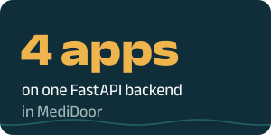
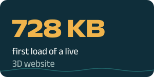
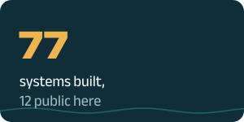

  

I build **AI chatbots**, **browser automation** and **full-stack web apps**, and I ship the whole product: the FastAPI backend, the Next.js front end, the admin panel and the Android app. Every number below links to the work behind it.

<table>
  <tr>
    <td></td>
    <td></td>
    <td></td>
    <td></td>
  </tr>
</table>

  
  
  
  

## Featured work

### [MediDoor](https://github.com/shizan52/MediDoor)
An AI-assisted medicine delivery platform built for Bangladesh. Customers, nearby pharmacies and riders work in one flow, with a web admin console on top. One FastAPI backend serves a responsive website and three Android apps.
 Next.js, React, TypeScript, Tailwind, FastAPI, PostgreSQL, Gemini, Android

<table>
  <tr>
    <td width="50%" valign="top">
      
      <h3><a href="https://github.com/shizan52/TikTok-Guard">TikTok-Guard</a></h3>
      Finds negative comments and drafts AI replies in the commenter's language. Nothing posts until a human approves it.
       Python, NLP, desktop app, Telegram bot
    </td>
    <td width="50%" valign="top">
      
      <h3><a href="https://github.com/shizan52/Software-Store">Software-Store</a></h3>
      A complete software shop in one app: landing page CMS, Google sign-in, free trials, device-bound licence keys and an admin panel.
       Flask, OAuth2, RSA signing, vanilla JS
    </td>
  </tr>
  <tr>
    <td width="50%" valign="top">
      
      <h3><a href="https://github.com/shizan52/AgentTrace">AgentTrace</a></h3>
      An AI web-scraping helper in one Python file. It drives real Chromium, finds the JSON API behind a page and takes tasks in English or Bangla.
       Python, Playwright, MCP server
    </td>
    <td width="50%" valign="top">
      <h3><a href="https://github.com/shizan52/Immersive-3D-Scrollytelling-Website">3D Scrollytelling Website</a></h3>
      A scroll-driven 3D street scene for an education consultancy, with a drag-and-drop CMS and an AI support chatbot. <a href="https://www.bdeducationcenter.online/"><b>See it live</b></a>.
       three.js, esbuild, Flask
      <h3><a href="https://github.com/shizan52/Personal-Artificial-Intelligence">Personal AI</a></h3>
      A fully local, privacy-first assistant with MCP tools, long-term memory, vision and PDF understanding. No cloud and no API keys.
       Ollama, MCP, FastAPI, OpenVINO
    </td>
  </tr>
</table>

**Also built:** [emt-booking-automation](https://github.com/shizan52/emt-booking-automation) (multi-passenger flight booking that stops at payment), [Phone-VPS](https://github.com/shizan52/Phone-VPS) (an old Android phone turned into a self-healing 24/7 server) and a [multi-level reseller admin panel](https://github.com/shizan52/admin-panel-for-managing-a-multi-level-reseller) (Flask and MySQL).

## How I build

- **Humans stay in control.** [My booking tool](https://github.com/shizan52/emt-booking-automation) stops at the payment page, and [TikTok-Guard](https://github.com/shizan52/TikTok-Guard) posts nothing without approval.
- **I ship the whole product.** [MediDoor](https://github.com/shizan52/MediDoor) has the backend, website, admin console and Android apps in one repo.
- **Tests before trust.** TikTok-Guard runs 699 tests with no network, so it can be checked by anyone in minutes.
- **Privacy comes first when the data is personal.** [Personal AI](https://github.com/shizan52/Personal-Artificial-Intelligence) runs on local models with no cloud keys.

## Tools I use

               

---

I work remotely and am open to full-stack and AI engineering roles, remote or hybrid in Dhaka, as well as freelance projects. The fastest way to reach me is [LinkedIn](https://www.linkedin.com/in/tayb-hassan-shizan-584980379) or [email](mailto:shizan305@gmail.com).
